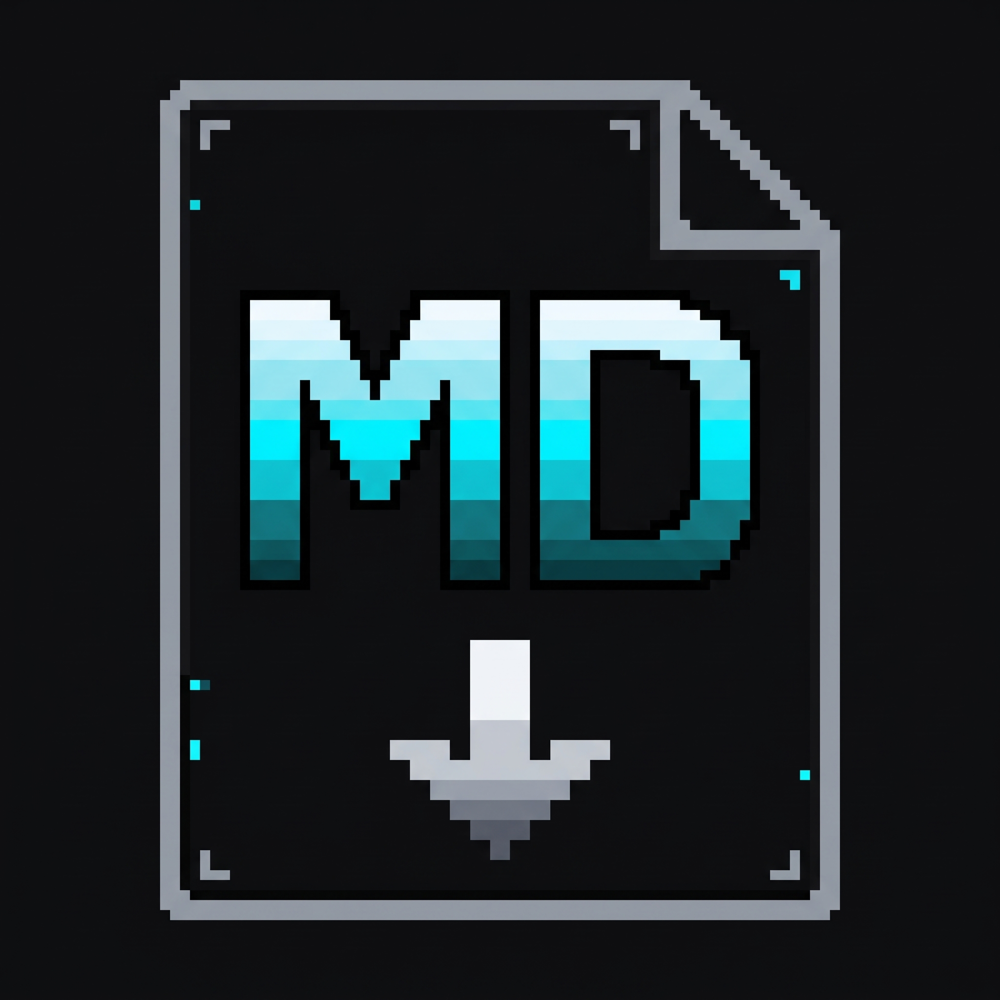

<p align="center">
  
</p>

# MarkItDown Studio

Desktop application for Microsoft Windows that converts documents, spreadsheets, presentations, and structured data into clean CommonMark Markdown using the Microsoft MarkItDown engine.

Designed with an offline-first architecture, zero external network dependencies, and a centered retro-cyber aesthetic.

---

## Overview

MarkItDown Studio provides a desktop interface for converting arbitrary document formats into structured Markdown. All processing occurs locally on the host machine without telemetry, tracking, or cloud reliance.

### Key Capabilities

- **Zero-Dependency Portable Release**: Precompiled standalone 64-bit Windows distribution executable without requiring a Python environment.
- **Offline Processing**: All document parsing is handled in-process via local libraries.
- **Automated Directory Discovery**: Automatically resolves the Windows Shell Downloads directory for outputs, with optional folder override and confirmation modes.
- **Full-Text In-App Viewer**: Renders full Markdown conversions with real-time character and line metrics, clipboard copy shortcuts, and file explorer integration.
- **Input Sanitization**: Path normalization and memory threshold enforcement to guard against malformed files and memory exhaustion.

---

## Supported Formats

| Category | File Extensions | Parser / Engine |
| :--- | :--- | :--- |
| **Documents** | `.pdf`, `.docx`, `.doc` | pdfminer.six, Mammoth, MarkItDown |
| **Spreadsheets** | `.xlsx`, `.xls`, `.csv` | OpenPyXL, Pandas / Standard CSV |
| **Presentations** | `.pptx`, `.ppt` | python-pptx |
| **Web & Data** | `.html`, `.json`, `.xml`, `.txt` | BeautifulSoup4, Standard Parsers |
| **Archives & Notebooks** | `.zip`, `.ipynb` | Zipfile, Nbformat |

---

## Installation & Distribution

### 1. Standalone Portable Package (Recommended for End Users)

The portable package requires no installation, no Python runtime, and no administrative privileges.

1. Download **`MarkItDown-Studio-v1.0.0-Windows-x64-Portable.zip`** from [GitHub Releases](https://github.com/Jouless-dev/markitdown-studio/releases/latest).
2. Extract the archive into any folder on your machine. The extracted folder contains:
   ```text
   MarkItDown Studio/
   ├── _internal/                     # Bundled runtimes, WebView2 DLLs, and Python environment
   ├── MarkItDown Studio.exe          # Application executable
   └── MarkItDown Studio.exe.config   # Runtime policy configuration
   ```
3. Double-click **`MarkItDown Studio.exe`** to launch.

> **Windows Defender SmartScreen Notice**: Because this application is an independent open-source release without a commercial code-signing certificate, Windows Defender SmartScreen may display an "Unrecognized application" prompt on the first launch. Click **More info** and select **Run anyway** to proceed.

---

### 2. Running from Source (Developers)

#### Prerequisites

- Windows 10 or Windows 11 (64-bit)
- Python 3.12 or later
- Microsoft Edge WebView2 Runtime (preinstalled on Windows 10/11)

#### Setup

```powershell
# Clone the repository
git clone https://github.com/Jouless-dev/markitdown-studio.git
cd markitdown-studio

# Initialize virtual environment
python -m venv .venv
.\.venv\Scripts\activate

# Install dependencies
pip install -r requirements.txt

# Launch application
python main.py
```

Alternatively, developers can execute the native launcher `MarkItDown.exe` in the root folder, which binds directly to the active `.venv` environment.

---

## Application Workflow

### Document Conversion

1. **Input**: Drag and drop one or multiple documents into the `$ DROP FILES TO CONVERT_` viewport, or click inside the viewport to browse using the native Windows file picker.
2. **Processing**: Progress is reported in real time with file counters and a status indicator.
3. **Storage**: Converted `.md` files are automatically saved to your output directory. If an identically named file exists, an incremental counter is appended to prevent data loss.

### Output Destination

- **Default Path**: Saves automatically to your Windows user `Downloads` directory (`C:\Users\<User>\Downloads`).
- **Custom Path**: Click **Change** to select any folder on your filesystem.
- **Prompt Mode**: Check **Ask where to save on each conversion** to select target directories on a per-batch basis.

### Markdown Inspection & Clipboard

- **View Full Output**: Click **View** on any item in the `Converted Files` list to inspect the complete Markdown document in a dedicated viewer modal with character and line counts.
- **Copy**: Click **Copy** to place the complete Markdown contents directly onto the Windows clipboard.
- **Open Directory**: Click **Open Dir** to reveal the saved file in Windows Explorer.

---

## Project Structure

```text
MarkItDown/
├── assets/                          # High-resolution icons and application graphics
│   ├── app.ico
│   ├── app.png
│   └── app_logo.ico
├── dist/                            # Packaged distributions and release archives
├── outputs/                         # Default local scratch folder for conversions
├── scripts/                         # Automation and build tooling
│   ├── build_portable.py            # PyInstaller standalone packager
│   ├── create_shortcut.ps1          # Windows Desktop shortcut generator
│   └── generate_icons.py            # Multi-resolution icon compiler
├── src/                             # Core application source code
│   ├── __init__.py                  # Python package marker
│   ├── ui/                          # Presentation layer (HTML5, CSS3, ES6)
│   │   ├── app.js                   # UI controller and PyWebView bridge calls
│   │   ├── favicon.png              # Browser runtime icon
│   │   ├── index.html               # Centered workspace layout
│   │   ├── markitdown-wordmark.svg  # Scalable pixel-art wordmark
│   │   └── style.css                # Design tokens, pixel borders, and layout
│   ├── app.py                       # PyWebView application bridge & Win32 hooks
│   ├── config.py                    # User configuration & registry discovery
│   └── converter.py                 # Microsoft MarkItDown engine wrapper
├── .gitignore                       # Git repository exclusion definitions
├── CONTRIBUTING.md                  # Developer contribution guidelines
├── LICENSE                          # MIT License terms
├── main.py                          # Python runtime entry point
├── MarkItDown.exe                   # Native compiled Windows launcher
├── MarkItDown Studio.exe.config     # .NET remote assembly policy configuration
├── README.md                        # Project documentation
├── requirements.txt                 # Locked Python dependency manifest
└── SECURITY.md                      # Security architecture & vulnerability reporting
```

---

## Build Automation

To compile a self-contained portable distribution from source:

```powershell
python scripts/build_portable.py
```

The script builds the standalone application into `dist/MarkItDown Studio/` and compresses it into `dist/MarkItDown-Studio-v1.0.0-Windows-x64-Portable.zip`.

---

## Security Model

- **Local Boundary**: The application executes zero outbound HTTP or WebSocket connections. All conversion logic is local.
- **Resource Constraints**: In-memory buffers for drag-and-drop operations are capped at 150 MB to prevent process memory exhaustion.
- **Path Traversal Mitigation**: File basenames are sanitized prior to disk writes, preventing directory escape attacks.
- See [SECURITY.md](SECURITY.md) for full policy details.

---

## Troubleshooting

### Windows Defender SmartScreen Warning

On first execution, Windows SmartScreen may show an "Unrecognized application" prompt. This occurs because the standalone executable is not signed with an enterprise EV certificate. Click **More info**, then click **Run anyway**.

Alternatively, you can unblock the downloaded ZIP archive before extraction: right-click the `.zip` file, select **Properties**, check the **Unblock** box at the bottom, and click **OK**.

### Missing WebView2 Runtime

MarkItDown Studio requires the Microsoft Edge WebView2 runtime, which is installed by default on Windows 10 (version 1803+) and Windows 11. If your system lacks the runtime, download the official Evergreen Bootstrapper from Microsoft.

---

## Contributing

Review [CONTRIBUTING.md](CONTRIBUTING.md) for workflow details, code standards, and pull request procedures.

---

## License

This project is licensed under the [MIT License](LICENSE).

Document conversion engine powered by [Microsoft MarkItDown](https://github.com/microsoft/markitdown).
